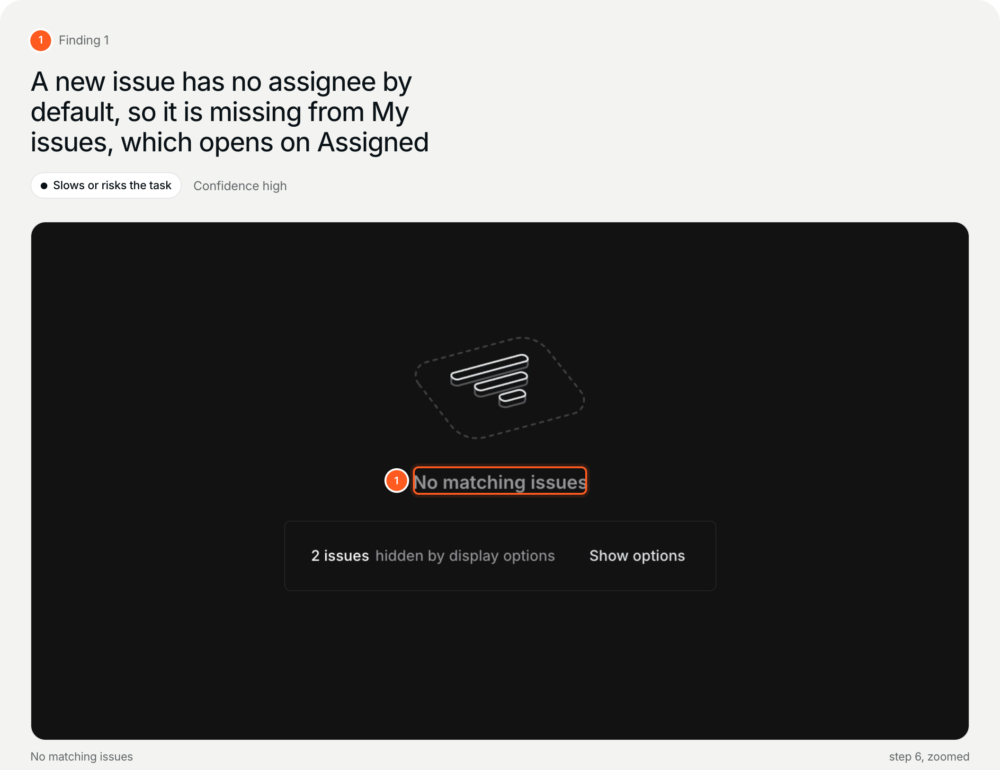

# ux-audit-agent: UX audit agent for Claude Code

A UX audit agent for Claude Code. It walks a task in your live web product, in your own browser, and writes an evidence-backed report with marked screenshots. Use it for an onboarding audit, a usability review of a flow, or a first-run check before launch.

[](https://r.ayurchenko.xyz/qCCvTw_m8gTs8lkTaILjvQ)

**Found in Linear:** a new issue has no assignee, and My issues opens on Assigned, so the issue you just made is not there. [Open the full example report](https://r.ayurchenko.xyz/qCCvTw_m8gTs8lkTaILjvQ). Its source data is in [`examples/report/`](examples/report/).

How it works:

1. You type `/audit`, give a URL and a task, or let it propose two or three core flows.
2. It walks them in a tab of your Chrome, Edge or Brave, capturing each screen and measuring elements in the DOM.
3. You get one HTML report: what to keep, cut and change, annotated findings, and priorities you can paste into Linear, Jira or GitHub.

## Install

In Claude Code:

```
/plugin marketplace add andyur/ux-audit-agent
/plugin install ux-audit-agent@andyur
```

Requirements: Node 20 or newer and a Chromium browser from 2026 (Chrome or Edge 144 or newer, Brave, Arc, Dia, Vivaldi, Opera). On first run the agent installs its one dependency, Playwright, which drives your browser; no separate browser is downloaded. Tested on macOS with Chrome and Brave.

## Which browser it uses

- **Your own browser (default, for every audit).** The agent finds the Chromium browser you have open (your default browser first) and opens one new tab in the window you already have open, in the profile you used last, so your sign-ins are already there, also for signup and onboarding audits. Your browser asks once per audit to allow the connection, and shows a bar saying it is controlled by automated software while the audit runs. The agent works only in the tab it opened and closes it at the end. This needs remote debugging switched on once. If it is off, the agent opens the switch page (`chrome://inspect/#remote-debugging`) in your browser and waits while you tick it; on a Mac the system first asks once whether Claude may control the browser. On Windows and Linux the address is copied for you to paste. Comet does not have the switch yet (Chromium 142); Safari and Firefox cannot be connected at all. Arc, Dia, Vivaldi and Opera are detected but not tested yet.
- **A separate window, if you ask.** If you would rather not connect your browser, or you use Safari or Firefox, the agent opens a separate Chrome, Edge or Brave profile where you sign in to the product once. With none of those installed, it can download Chromium (about 150 MB) if you agree.
- **A clean profile, if you ask.** A throwaway window with no saved data, for when saved sessions would change what a new user sees.

## Use

```
/audit
```

The agent asks for the product URL and how deep to go (Quick, Standard or Deep, see the FAQ), then for the task or the flows, what counts as success, and the moment of first value. The report is written to `audit/index.html` in your working folder; `ux-audit render --single` also writes one shareable file with every screenshot embedded.

## Shareable link (optional)

After a report is built, the agent can offer a link your team can open in a browser. Nothing is uploaded unless you say yes. The single-file report is stored on `r.ayurchenko.xyz` for 30 days, then deleted automatically; the author can see shared reports. The link opens the report in a sandbox, without tracking scripts. To remove it earlier, ask Claude to run `ux-audit unshare`, or open the manage link once and use Delete link on the report.

## What it will not do

- Create accounts, type passwords or pass 2FA. If the task needs an account, you sign in yourself.
- Read your other tabs, passwords, cookies or history in your own browser.
- Delete, pay, subscribe, send, publish or invite without asking you first.
- Invent conversion, revenue or user research. Findings without evidence are refused by the validator.

## Privacy

Everything runs on your machine and your Claude account. Screenshots, data and the report stay in your folder. Nothing is sent to the author unless you choose to share a link (see above). The report links to the author's site; those links carry a `utm_source` tag and nothing else.

## How it is built

- `skills/audit/SKILL.md`: the audit protocol the agent follows.
- `cli/ux-audit.mjs`: browser steps (start, act, capture, measure, render, stop).
- `render/`: the validator and the report renderer. Font: Inter, SIL OFL 1.1.
- `docs/`: protocol, report design and implementation notes.

## FAQ

### How do I run a UX audit with Claude Code?

Install the plugin (see Install), open Claude Code in any folder and type `/audit`. Give the product URL and one task. The agent asks what counts as success, walks the task in your browser, and writes `audit/index.html`.

### Can it audit a product that needs a login?

Yes. It works in a tab of the browser you already use, so you are already signed in. If the product shows a sign-in or signup screen, you sign in yourself in that tab; the agent never types passwords or creates accounts.

### Which browsers does it work with?

Chromium browsers: Chrome and Edge 144 or newer, Brave, and Arc, Dia, Vivaldi and Opera (detected, not tested yet). Comet does not have the remote debugging switch yet. Safari and Firefox cannot be connected; with them the agent offers a separate Chrome window.

### Does it audit the whole product?

No, but it can cover more than one task. Before it starts, the agent asks how deep to go. **Quick** walks one task you name. **Standard**, the default, looks at your product and proposes two or three core flows (first value, the path to paying, a return visit) for you to confirm. **Deep** adds each flow's edges: empty states, input errors, recovery, settings defaults and a phone-width check. Every flow is walked end to end, so each finding has a screenshot and a measurement behind it, and the report shows all flows on one page with shared priorities and the problems they have in common.

### What leaves my machine?

Nothing, unless you ask for a shareable link. Screenshots, data and the report stay in your folder, and the model runs on your own Claude account.

## License

[PolyForm Shield 1.0.0](LICENSE.md). You may use and change it, including at work and on your company's products. You may not use it to build a product or service that competes with the author's, such as a rebranded audit tool or audit service.

Made by [Andriy Yurchenko](https://ayurchenko.xyz/about), AI product architect and designer. Why I built it and how it works: [Free AI UX audit tool for Claude Code](https://ayurchenko.xyz/writing/ux-audit-agent).

Required Notice: Copyright Andriy Yurchenko (https://ayurchenko.xyz). Under the license, this line and `LICENSE.md` stay with every copy, changed or not.
